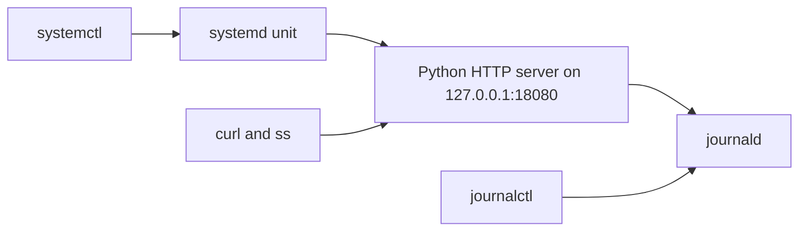

# Service management, logs and network troubleshooting
A fourth Linux Operations lab. Uses a loopback-only HTTP service to practice diagnosis without exposing a network service to the internet.

## Architecture


## Systemd exercise (disposable Ubuntu VM)
Requires systemd as PID 1, Python 3, curl and iproute2. Check that port 18080 is free and that ops-demo.service and /var/empty/ops-demo do not already exist; do not overwrite existing files. Run from this directory.

```bash
ps -p 1 -o comm=
ss -ltn 'sport = :18080'
systemd-analyze verify ./ops-demo.service
sudo install -d -m 0755 /var/empty/ops-demo
printf 'ops-demo-ok\n' | sudo tee /var/empty/ops-demo/index.html
sudo install -m 0644 ops-demo.service /etc/systemd/system/ops-demo.service
sudo systemctl daemon-reload
sudo systemctl start ops-demo
systemctl status ops-demo --no-pager
systemctl is-active ops-demo
sudo journalctl -u ops-demo -n 30 --no-pager
ss -ltn 'sport = :18080'
curl -fsS http://127.0.0.1:18080/
curl -s -o /dev/null -w '%{http_code}\n' http://127.0.0.1:18080/missing
sudo journalctl -u ops-demo --since '5 minutes ago' --no-pager
sudo systemctl stop ops-demo
curl --max-time 2 -v http://127.0.0.1:18080/
sudo systemctl start ops-demo
sudo systemctl restart ops-demo
systemctl is-active ops-demo
```

Expected: active service and HTTP 200, HTTP 404 for a nonexistent file, connection refused after stopping, then successful response after restart. An intentionally stopped service is not automatically restarted by Restart=on-failure. Use systemctl enable only if boot persistence is desired in your lab VM; it does not start a service unless --now is specified. For a failed start, inspect status and journal first, then check the executable, directory permissions and port conflicts before attempting a restart.

## Networking checklist
- `ip -br addr`: interface and address; `ip route`: route and default gateway.
- `getent hosts localhost`: local name resolution via NSS (not proof that external DNS works).
- `ss -ltnp`: listening TCP sockets and process details where permitted.
- `curl -v --connect-timeout 2 http://127.0.0.1:18080/`: connection and HTTP diagnosis. Refused usually means no listener or explicit rejection; timeout is a different symptom.
- `ping -c 3 127.0.0.1`: optional ICMP loopback check; does not test HTTP.
- `sudo ufw status verbose`: optional read-only firewall inspection if UFW is installed. No firewall changes required. Never disable firewalls to troubleshoot.

## Evidence
On a Linux container on 27 Nov 2026, the unit passed `systemd-analyze verify` (exit 0). A directly launched Python HTTP server on an available loopback port passed four independent checks: HTTP content/200, listening TCP socket via ss, HTTP 404, and curl exit 7 (connection refused) after termination. Localhost resolution and route inspection also ran successfully. The container does not use systemd as PID 1: the privileged systemctl/journalctl lifecycle exercise and firewall inspection remain VM practice, not completed live tests. No production administration is claimed.

## Cleanup
Only remove resources created by this lab.
```bash
sudo systemctl disable --now ops-demo
sudo rm /etc/systemd/system/ops-demo.service
sudo systemctl daemon-reload
sudo rm /var/empty/ops-demo/index.html
sudo rmdir /var/empty/ops-demo
```

## Interview drill
1. Active service but curl fails? Check listener address/port, URL, logs and route before considering firewall policy.
2. HTTP 404 vs connection refused? 404 means the HTTP server responded; refusal means a TCP connection was not established.
3. systemctl start vs enable? Start runs now; enable configures startup dependencies.
4. journalctl -u vs status? Unit-specific history vs a current state summary and recent logs.
5. Why bind to loopback? Keeps this learning service reachable only locally.
